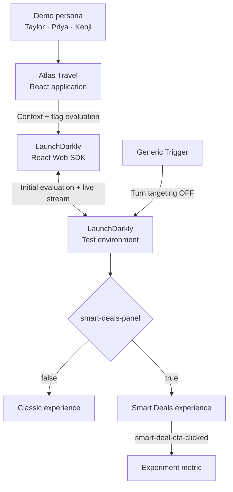

<div align="center">

# Atlas Travel

### A LaunchDarkly release, rollback, targeting, and experimentation demo

One deployment. A safer way to release.


</div>

---

## Overview

Atlas Travel is a frontend-only customer demonstration built for the LaunchDarkly Solutions Engineer technical exercise. It models a high-traffic APJ travel homepage releasing a personalized **Smart Deals** panel safely.

Both the existing Classic experience and the new Smart Deals experience are included in the same build. LaunchDarkly controls which experience each visitor receives, allowing the team to change release behavior without rebuilding or redeploying the application.

The demonstration covers:

- Releasing a feature independently of deployment
- Receiving streaming flag updates without refreshing the page
- Rolling back automatically with a Generic Trigger
- Individually targeting a QA context
- Targeting Premium customers through a context attribute
- Providing a safe default for everyone else
- Tracking a custom conversion event for optional Experimentation

> **The customer story:** Atlas Travel can deploy once, release gradually, contain an incident, relaunch to a smaller audience, and measure customer behavior—all with one feature flag.

## Table of contents

- [How the demo works](#how-the-demo-works)
- [Technology](#technology)
- [Getting started](#getting-started)
- [LaunchDarkly configuration](#launchdarkly-configuration)
- [Demo personas](#demo-personas)
- [Run the demonstration](#run-the-demonstration)
- [Optional Experimentation](#optional-experimentation)
- [Project structure](#project-structure)
- [Available commands](#available-commands)
- [Troubleshooting](#troubleshooting)
- [Security](#security)
- [Further documentation](#further-documentation)

## How the demo works



The browser sends the selected persona as a LaunchDarkly `user` context. LaunchDarkly evaluates `smart-deals-panel` for that context and returns a Boolean variation:

- `false` renders the Classic destination experience.
- `true` renders the personalized Smart Deals experience.
- If LaunchDarkly is unavailable, the application safely falls back to `false`.

The React SDK maintains a streaming connection, so saved flag changes can update the page without a browser refresh.

## Technology

| Technology | Purpose |
| --- | --- |
| React 19 with JavaScript | Application and component model |
| Vite 6 | Local development and production build |
| LaunchDarkly React Web SDK 4 | Flag evaluation, context identification, streaming updates, and events |
| Plain CSS | Responsive presentation layer |
| Static local data | Repeatable personas and travel content |

The project intentionally has no backend, database, authentication service, UI framework, paid asset, remote font, or external content API.

## Getting started

### Prerequisites

- [Node.js](https://nodejs.org/) 20.12 or newer
- npm
- A LaunchDarkly account with access to a project and environment

### 1. Install the application

After cloning the repository, open its directory and run:

```bash
npm ci
```

### 2. Create the local environment file

```bash
cp .env.example .env.local
```

The React Web SDK requires the environment's **Client-side ID**—not the environment key and not a server-side SDK key.

To find it in LaunchDarkly:

1. Select the gear icon in the left navigation.
2. Open **Organization settings**.
3. Under **Security**, select **SDK keys**.
4. Select the project and the **Test** environment.
5. Copy the **Client-side ID**.

See [SDK credentials](https://launchdarkly.com/docs/home/account/environment/keys) and the [React Web SDK reference](https://launchdarkly.com/docs/sdk/client-side/react/react-web) in the official LaunchDarkly documentation.

Add the value to `.env.local`:

```text
VITE_LD_CLIENT_SIDE_ID=your-client-side-id
```

The Client-side ID is designed for browser SDKs and is not a secret. Never substitute a server-side SDK key.

### 3. Start the application

```bash
npm run dev
```

Open [http://localhost:5173](http://localhost:5173).

If the Client-side ID is missing, Atlas Travel displays a setup screen rather than silently connecting to the wrong environment.

### 4. Verify the production build

```bash
npm run verify
```

## LaunchDarkly configuration

All the configuration below should be created in the same **Test** environment whose Client-side ID is stored in `.env.local`.

### 1. Create or select a project and environment

Create the project through the LaunchDarkly web UI. A project named **Atlas Travel Demo** with a **Test** environment is easy to recognize during the presentation.

Each LaunchDarkly environment has its own credentials and targeting configuration. Read [Environments](https://launchdarkly.com/docs/home/account/environment) for the underlying model.

### 2. Create the feature flag

Open **Feature flags**, select **Create flag**, and use:

| Setting | Value |
| --- | --- |
| Name | Smart Deals Panel |
| Key | `smart-deals-panel` |
| Type | Boolean |
| `true` variation | Smart Deals experience |
| `false` variation | Classic experience |
| Off variation | `false` |
| SDK fallback in the application | `false` |
| Client-side SDK availability | Enabled |

The key must be exactly `smart-deals-panel`; it is the contract between the LaunchDarkly configuration and the application code.

Ensure the flag is available to client-side SDKs. Client-side SDKs can only evaluate flags included in their payload. See [Choosing an SDK type](https://launchdarkly.com/docs/sdk/concepts/client-side-server-side) and [Creating flags](https://launchdarkly.com/docs/home/flags/new).

### 3. Configure the controlled audience

These two rules can be prepared before presenting.

#### Individual target

| Field | Value |
| --- | --- |
| Context kind | `user` |
| Context key | `qa-priya` |
| Serve | `true` |

This gives the QA persona access even though her customer tier is Standard.

#### Premium attribute rule

| Field | Value |
| --- | --- |
| Context kind | `user` |
| Attribute | `user_tier` |
| Operator | `is one of` |
| Value | `Premium` |
| Serve | `true` |

LaunchDarkly evaluates individual targets before custom rules, then uses the default rule if nothing matched. See [Targeting with flags](https://launchdarkly.com/docs/home/flags/target), [Targeting rules](https://launchdarkly.com/docs/home/flags/target-rules), and the [flag evaluation hierarchy](https://launchdarkly.com/docs/guides/flags/flag-hierarchy).

### 4. Prepare the initial release state

Before beginning the demonstration, configure:

```text
Targeting: OFF
Off variation: false
Default rule: true
```

With targeting off, everyone receives the off variation (`false`). When targeting is turned on, the initial default rule (`true`) releases Smart Deals to everyone.

### 5. Create the incident-remediation trigger

Yes—the trigger is created under the `smart-deals-panel` flag for the Test environment:

```text
Smart Deals Panel
  → Test environment three-dot menu
  → Configuration in environment
  → Triggers
  → Add trigger
```

Configure:

| Field | Value |
| --- | --- |
| Trigger type | Generic trigger |
| Action | Update flag targeting to OFF |

Save the trigger and copy its unique URL immediately. LaunchDarkly obscures the complete URL after leaving the page. Follow [Creating flag triggers](https://launchdarkly.com/docs/home/releases/triggers-create) for the official workflow.

During the demonstration, invoke it directly:

```bash
curl -X POST 'PASTE_THE_COMPLETE_TRIGGER_URL_HERE'
```

The trigger URL is credential-like. Do not add the real value to this README, application code, shell scripts, screenshots, or Git history. Pasting it directly into the terminal is convenient for a one-time demo, but it will remain in local shell history; delete and recreate the trigger after the interview if needed.

### 6. Prepare the targeted relaunch

After the rollback trigger turns targeting off:

1. Keep targeting off while editing the flag.
2. Confirm the Priya individual target serves `true`.
3. Confirm the Premium rule serves `true`.
4. Change the default rule from `true` to `false`.
5. Save the targeting configuration.
6. Turn targeting on.

The resulting evaluation is:

```text
If targeting is OFF:
    Serve false to everyone.

If targeting is ON:
    If user key is qa-priya, serve true.
    Otherwise, if user_tier is Premium, serve true.
    Otherwise, serve false.
```

## Demo personas

| Persona | Context key | `user_tier` | Why the variation is served | Expected targeted result |
| --- | --- | --- | --- | --- |
| Taylor | `customer-taylor` | `Standard` | Default rule | Classic (`false`) |
| Priya | `qa-priya` | `Standard` | Individual target | Smart Deals (`true`) |
| Kenji | `customer-kenji` | `Premium` | Attribute rule | Smart Deals (`true`) |

The application calls `identify()` when the presenter changes personas. The flag is then evaluated for the new context. Learn more in [An introduction to contexts](https://launchdarkly.com/docs/home/flags/contexts/intro) and [Context attributes](https://launchdarkly.com/docs/home/flags/context-attributes).

## Run the demonstration

The complete presentation takes approximately seven to nine minutes.

### Stage 1 — Show the safe starting point

1. Keep flag targeting off.
2. Open Atlas Travel with Taylor selected.
3. Show the Classic destination experience.
4. Point out that the off variation and SDK fallback are both `false`.

**Message:** both experiences are deployed, but the new experience has not been released.

### Stage 2 — Release Smart Deals

1. In LaunchDarkly, confirm the default rule serves `true`.
2. Turn targeting on and save.
3. Do not refresh Atlas Travel.
4. Watch Smart Deals appear through the SDK's streaming connection.
5. Point out the toast and Live Delivery Console update.

**Message:** the release happened without changing code or redeploying the application.

### Stage 3 — Remediate the simulated incident

1. Explain that monitoring detected an elevated Smart Deals error rate.
2. Run the Generic Trigger command:

   ```bash
   curl -X POST 'PASTE_THE_COMPLETE_TRIGGER_URL_HERE'
   ```

3. Watch the Classic experience return without refreshing.
4. Confirm in LaunchDarkly that targeting is now off.

**Message:** operations contained the incident immediately, without a rollback deployment.

### Stage 4 — Relaunch to a controlled audience

1. While targeting remains off, set the default rule to `false`.
2. Show the `qa-priya → true` individual target.
3. Show the `user_tier = Premium → true` rule.
4. Save the changes and turn targeting on.
5. Test the three application personas:

   - **Taylor** remains on Classic through the default rule.
   - **Priya** receives Smart Deals through individual targeting.
   - **Kenji** receives Smart Deals through the Premium rule.

6. Point out the evaluation reason in the Live Delivery Console.

**Message:** turning targeting on does not mean exposing everyone; LaunchDarkly evaluates each context against the release policy.

### Stage 5 — Close the core demonstration

> “The same flag lets Atlas Travel release independently, contain its blast radius, recover immediately, relaunch to the right audience, and keep the deployed application unchanged.”

## Optional Experimentation

Atlas Travel emits a custom event when the Smart Deals CTA is selected:

```text
smart-deal-cta-clicked
```

### Create the metric

Create a custom conversion metric with:

| Setting | Value |
| --- | --- |
| Name | Smart Deal CTA Clicked |
| Event key | `smart-deal-cta-clicked` |
| Metric definition | Occurrence (Percent) |
| Analysis unit | `user` |
| Success criteria | Higher is better |

See [Custom conversion binary metrics](https://launchdarkly.com/docs/home/metrics/custom).

### Create the experiment

Open the Premium rule's three-dot menu and select **Create experiment from rule**, or create an experiment from the global Create menu.

Use:

| Setting | Value |
| --- | --- |
| Hypothesis | Smart Deals increases featured-deal engagement for Premium customers |
| Randomize by | `user` |
| Metric source | LaunchDarkly |
| Metric | Smart Deal CTA Clicked |
| Flag | `smart-deals-panel` |
| Audience | `user_tier is one of Premium` rule |
| Control | `false` — Classic |
| Treatment | `true` — Smart Deals |

The flag must be on before starting an experiment iteration. See [Creating experiments](https://launchdarkly.com/docs/home/experimentation/create) and the [Experimentation quickstart](https://launchdarkly.com/docs/home/experimentation/quickstart).

This demo does not generate enough traffic for a statistically meaningful result. The goal is to demonstrate correct flag evaluation, audience selection, metric instrumentation, and experiment design—not to claim that one variation has won.

## Project structure

```text
.
├── docs/
│   ├── demo-script.md             # Seven-minute presenter script
│   ├── launchdarkly-setup.md      # Detailed LaunchDarkly configuration
│   └── troubleshooting.md         # Common setup and demo issues
├── src/
│   ├── components/
│   │   ├── ClassicExperience.jsx
│   │   ├── DemoConsole.jsx
│   │   ├── PersonaSwitcher.jsx
│   │   └── SmartDealsExperience.jsx
│   ├── data/personas.js           # Taylor, Priya, and Kenji contexts
│   ├── App.jsx                    # Flag evaluation and SDK interactions
│   ├── SetupScreen.jsx            # Missing-credential guidance
│   ├── icons.jsx
│   ├── main.jsx                   # LaunchDarkly provider initialization
│   └── styles.css
├── .env.example
├── index.html
├── package.json
└── vite.config.js
```

## Available commands

| Command | Purpose |
| --- | --- |
| `npm run dev` | Start the local Vite server |
| `npm run build` | Create the production bundle |
| `npm run preview` | Preview the production bundle locally |
| `npm run verify` | Run production build verification |

## Troubleshooting

### The setup screen appears

Confirm `.env.local` exists and contains:

```text
VITE_LD_CLIENT_SIDE_ID=your-client-side-id
```

Restart `npm run dev` after changing an environment file.

### The application always shows Classic

Check that:

- The flag key is exactly `smart-deals-panel`.
- The flag is available to client-side SDKs.
- The Client-side ID and flag belong to the same environment.
- Targeting is on when testing individual targets and rules.

### Priya does not receive Smart Deals

Confirm the individual target uses the context kind `user` and exact key `qa-priya`.

### Kenji does not receive Smart Deals

Confirm the custom rule uses the exact attribute and case-sensitive value:

```text
user_tier is one of Premium
```

### Taylor receives Smart Deals during the targeted relaunch

Set the default rule to `false`. The initial universal release uses default `true`; the controlled relaunch uses default `false`.

### Changes do not appear without refreshing

Confirm the browser is online, the Client-side ID is correct, and the flag belongs to the selected Test environment. Then inspect the browser console and the in-app Live Delivery Console.

For additional diagnostics, see [docs/troubleshooting.md](docs/troubleshooting.md).

## Security

- Use the browser-safe Client-side ID in the React application.
- Never place a server-side SDK key or API access token in frontend code.
- Never prefix the trigger URL with `VITE_`; Vite exposes `VITE_` variables to browser code.
- Never commit `.env.local`, `.env.trigger.local`, real trigger URLs, or other local credentials.
- Treat the Generic Trigger URL as credential-like because invoking it changes flag state.
- Consider deleting and recreating the trigger after presenting if its URL appeared on screen or in shell history.

## Further documentation

### Repository guides

- [Detailed LaunchDarkly setup](docs/launchdarkly-setup.md)
- [Seven-minute demonstration script](docs/demo-script.md)
- [Troubleshooting guide](docs/troubleshooting.md)

### Official LaunchDarkly documentation

- [React Web SDK](https://launchdarkly.com/docs/sdk/client-side/react/react-web)
- [SDK credentials](https://launchdarkly.com/docs/home/account/environment/keys)
- [Contexts and attributes](https://launchdarkly.com/docs/home/flags/contexts/intro)
- [Targeting rules](https://launchdarkly.com/docs/home/flags/target-rules)
- [Flag evaluation hierarchy](https://launchdarkly.com/docs/guides/flags/flag-hierarchy)
- [Creating flag triggers](https://launchdarkly.com/docs/home/releases/triggers-create)
- [Custom conversion metrics](https://launchdarkly.com/docs/home/metrics/custom)
- [Creating experiments](https://launchdarkly.com/docs/home/experimentation/create)

## License

Distributed under the MIT License. See [LICENSE](LICENSE) for details.

---

<div align="center">

Built as an illustrative LaunchDarkly customer demonstration.

</div>
